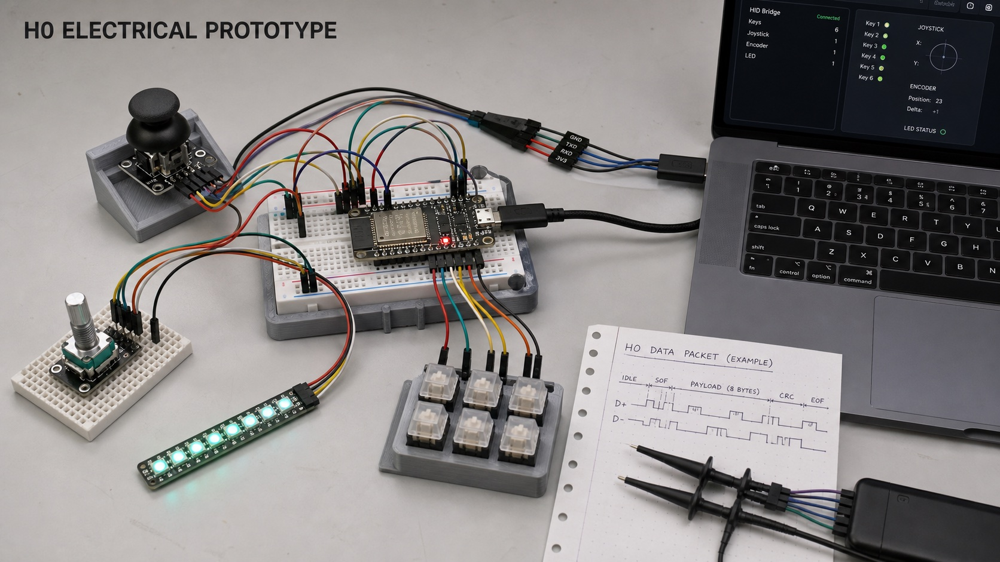
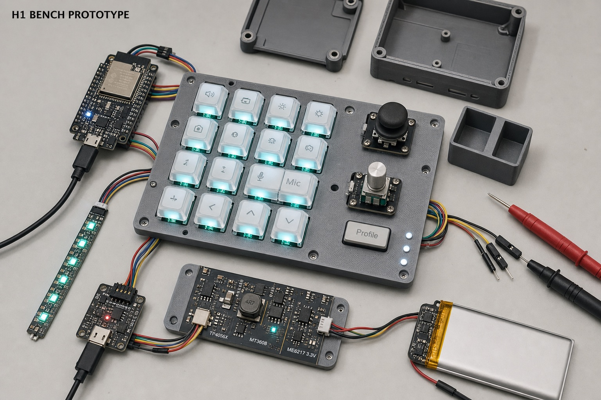
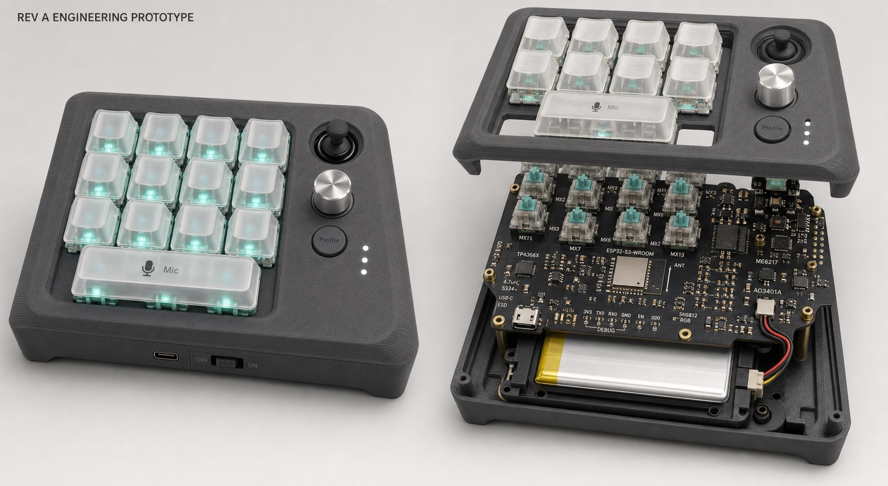
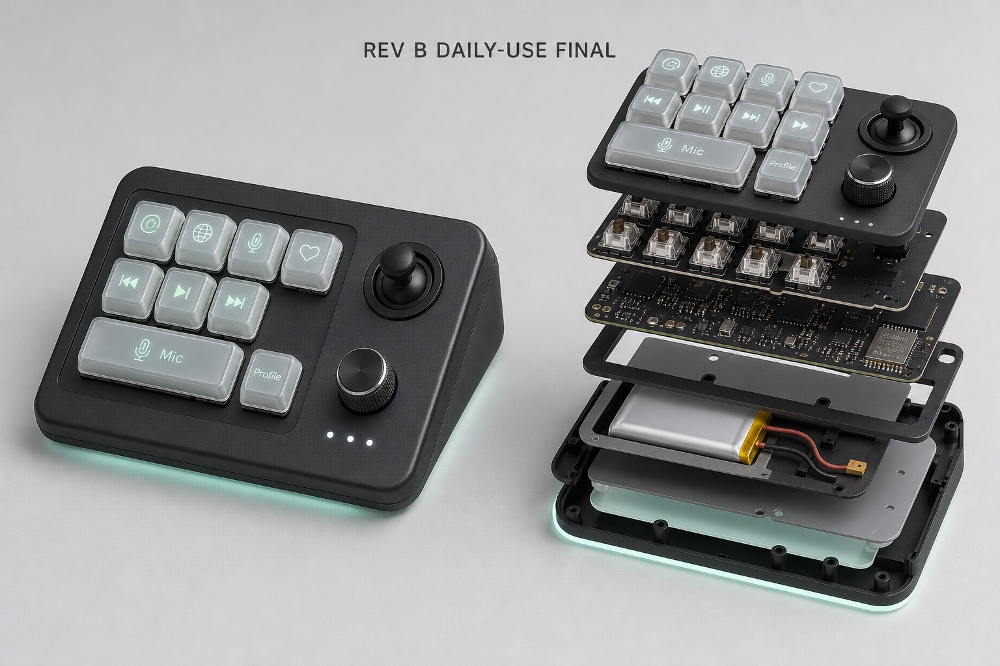

# Agent Bridge 硬件阶段目标与最终形态

> 状态：阶段目标基线 v1.3
> 日期：2026-08-03
> 范围：H0、H1、Rev A、Rev B 的完成定义、最终实物形态和阶段门槛
> 协议依据：[AGENT_BRIDGE_PROTOCOL_V1.md](./AGENT_BRIDGE_PROTOCOL_V1.md)

## 1. 文档用途

本文档回答两个问题：每个硬件阶段结束时必须证明什么，以及该阶段最终做出来的实物大致是什么形态。

阶段关系不是四种并行产品，而是逐级降低风险：

```text
H0 核心链路可行
        ↓
H1 全部功能和电源可行
        ↓
Rev A 定制 PCB 与完整结构可行
        ↓
Rev B 稳定日用终版
```

本文中的图片是概念示意，用于说明集成程度、体积层次和内部构造，不是 PCB、GPIO、BOM、尺寸或 CAD 的生产依据。图片中的键位数量、器件位置和外壳比例可能经过视觉简化；工程实现始终以原理图、PCB、GPIO 表和 CAD 为准。

## 2. 阶段总览

| 阶段 | 核心问题 | 阶段结束时的实物 | 主 PCB 状态 | 是否完整装壳 |
|---|---|---|---|---|
| H0 | 核心输入、协议和 USB 链路是否成立 | 开发板、6 键、摇杆、编码器和少量 RGB 组成的最小台架 | 无定制主 PCB | 否 |
| H1 | 全部控件、USB/BLE、电池和灯光能否共同稳定工作 | 13 键全功能台架、独立电源测试板、全尺寸定位板和简化外壳 | 仅必要的 H1 测试小板 | 简化装配 |
| Rev A | 能否集成为一台完整的定制硬件 | 定制四层 PCB、完整外壳、电池、键帽及全部控件 | 第一版定制主 PCB | 是 |
| Rev B | Rev A 暴露的问题是否已修正到适合长期日用 | 修正后的最终主板、成熟外壳、最终键帽和生产包 | 最终修订版 | 是 |

## 3. H0：协议和电气样机

### 3.1 最终阶段目标

H0 的目标是证明一条最小但真实的纵向链路成立：

```text
物理按键 / 摇杆 / 编码器
          ↓
ESP32-S3 固件
          ↓ USB Vendor HID
Agent Bridge App
          ↓
产生与虚拟控件等价的 Intent
```

H0 不追求全部功能、续航、完整结构或最终器件集成。它必须尽早暴露协议、USB、输入语义、断线恢复和 macOS 权限问题。

### 3.2 最终实物形态



H0 结束时的实物应保持最小和易改线：

- `ESP32-S3-DevKitC-1-N8R8` 开发板和 USB 数据线。
- 4–6 个临时 MX 按键；本阶段目标装配 6 个。
- 一个以 3.3V 供电的标准 PS2 游戏双轴摇杆模块；只连接 X/Y，Z/SW 按压脚保持不接。
- 一个带按压的 EC11 编码器。
- 一条 WS2812B 8位 RGB 开发板，通过 `74AHCT125N` 接收 5V 逻辑数据，用于验证最小状态反馈。
- 面包板、短杜邦线、测试钩、简易打印底座和小型按键定位板。
- Mac 端输入监视、日志和 H0 证据采集工具。

H0 不包含电池、充电电路、完整 13 键、三 Profile BLE、最终主 PCB 或完整外壳。

### 3.3 完成门槛

- USB 使用 ABP v1 的 Vendor-defined HID 帧，物理控件与虚拟控件产生等价 Intent。
- 一个 Agent Key、一个 Action Position、摇杆和编码器完成真实纵向切片。
- 端到端 USB 输入延迟 p95 小于 100ms。
- 非法、截断、未知版本和畸形帧 fail closed，不产生输入副作用。
- USB 拔插、设备重启和序列缺口进入快照恢复，不重放历史输入。
- 按住输入时断线不会在 App 中留下永久按下状态。

通过 H0 只代表核心链路成立，不代表可以进入日常使用。

## 4. H1：全功能台架

### 4.1 最终阶段目标

H1 的目标是证明产品要求中的全部功能能在同一台架上共同工作，并获得 Rev A 原理图、器件和结构冻结所需的实测数据。

H1 必须覆盖：

- 13 个物理开关，以及 ACT10/ACT11 的 Combined/Split Mic 行为。
- 摇杆、带按压编码器、Profile Key 和 3 个 Profile LED。
- 完整按键 RGB 和环境 RGB，带总功率限制及 Auto-dim。
- USB、BT1、BT2、BT3 四种明确的 Connection Mode。
- 三个 BLE Host/Bond 槽位，USB 与 BLE 承载相同 ABP v1 语义。
- Claim/Auth、断线恢复、快照同步和不重放。
- 电池供电、USB 充电、电池电压估算、低电量及 LED Rail 关断。
- 全尺寸定位板、简化上下壳、摇杆/编码器支架和电池托架或占位块。

### 4.2 最终实物形态



H1 是“功能完整、结构仍然开放”的工程台架：

- 主控仍使用 `ESP32-S3-DevKitC-1-N8R8` 开发板。
- 13 个开关、完整 RGB、摇杆、编码器和 Profile 控件安装在全尺寸定位板或简化上壳上。
- H1 电源小板独立放置，暴露关键测试点，使用短线束连接主控、RGB 和电池。
- 另制作 1–2 键测试小板，使用正式候选热插拔轴座、反贴 RGB 和矩阵二极管，提前验证按键单元封装、灯珠方向、轴座受力和下壳净空。
- 电池安装在可观察、可测温且绝缘的临时托架中。
- 简化外壳可以合拢部分结构，但应允许探测电源轨、替换器件和修改接线。
- 示波器、万用表、电源分析仪和热电偶属于验证台架，不属于最终设备。

H1 不要求把所有器件做进一张主 PCB，也不追求最终键帽、最终外观和量产级装配。

### 4.3 H1 电源形态

H1 当前采用 FunModularKeyboard 派生方案作为验证基线；只有通过本阶段电源 Gate 后，Rev A 才允许原样集成，否则必须先形成电源 ECO：

```text
USB-C 5V ──→ TP4056X ──→ BAT+ ──→ 1S LiPo（自带 PCM）
     │
     └── 开关 ──→ SS34 (D_USB) ───────→ V5_SYS

BAT+ ── 开关 ──→ MT3608 + 4.7µH + SS34 (D_BOOST) ──→ V5_SYS
V5_SYS ──→ ME6217C33M5G ──→ V3V3
V5_SYS ──→ AO3401A 高边开关 ──→ VLED
                    ↑ V5_SYS 上拉 + 2N7002 开漏下拉
BAT+ ──→ 1MΩ/1MΩ + 100nF ──→ ESP32 ADC
```

该方案不是动态 PowerPath，没有电池 NTC，也没有独立 Fuel Gauge。H1 必须验证系统负载对充满终止的影响；只允许使用两线、自带 PCM、极性明确、允许至少 1A 充电的正规 1S LiPo。`D_USB` 和 `D_BOOST` 分别承担 USB 隔离与 Boost 整流，不能用一颗器件含糊代替两个位置。AO3401A 必须通过 5V 上拉和 2N7002/等价开漏级驱动，不能由 3.3V GPIO 直接驱动。MT3608 功率回路必须制作专用 H1 小 PCB，不能用长杜邦线在面包板搭建。DevKit 的 USB、5V 和 3.3V 供电必须互斥，H1 接线图需要明确唯一注入和隔离路径，不能并联板载 LDO 与 ME6217 输出。

### 4.4 完成门槛

- 13 键、Mic Pair、摇杆、编码器、Profile 和全部 RGB 功能通过。
- 多台 Mac 可完成 USB、BT1、BT2、BT3 切换，USB/BLE 的输入和状态语义一致。
- 按住 Mic 或其他输入时断线、重连和切换 Profile 不造成卡键或重放。
- USB↔电池切换无无故复位、反向灌电或不可接受 Rail 冲突；硬电源开关关闭后主系统/RGB停止，但USB仍可充电。
- DevKitC 的 USB-C 两种插入方向均枚举为同一 ESP32-S3 Vendor HID 设备，不出现方向相关功能差异；该结果只作为固件、线缆和主机基线，不能替代 Rev A 自定义 USB-C 接口验收。
- 关机充电、开机轻载充电、典型负载充电、接近满电终止、低电量、Auto-dim、Boost满载和温升均有实测记录；边充边用或终止行为不通过时，H1 不得退出，必须完成 PowerPath ECO、替换 H1 电源小板并重新测试通过后才能进入 Rev A。
- VLED 上电和复位时默认关闭，AO3401A 关断电压、漏电和切换波形通过实测；通过 220/470/1000/1200µF 候选对比冻结 Rev A 是否装配 Bulk、最终容量、封装尺寸和 PCB 占位。
- 1–2 键测试小板完成按键扫描、RGB 数据链、灯珠方向、热插拔受力及下方器件/外壳净空验证，结果足以冻结 Rev A 按键单元封装。
- ADC 电池电压对照万用表完成校准；App 电量百分比明确标注为近似值。
- 连续运行 24 小时无卡键、崩溃或无界资源增长。
- 完成典型续航、待机功耗、RGB功率和BLE稳定性测试，结果足以冻结Rev A设计输入。

通过H1才允许冻结Rev A原理图、关键器件、GPIO和机械尺寸。

## 5. Rev A：完整装壳工程样机

### 5.1 最终阶段目标

Rev A 的目标是把 H1 验证过的功能和器件集成到一张定制主 PCB 与完整结构中，做出第一台能够真实装壳和长期试用的工程样机。

Rev A 不是简单把 H1 的测试板塞进外壳，而是完成电气、结构、固件和生产资料的第一次正式集成。

### 5.2 最终实物形态



Rev A 结束时应形成：

- 一张定制四层主 PCB，使用 `ESP32-S3-WROOM-1-N8R8`，集成 USB-C、矩阵、RGB、电源、ADC、Recovery 和调试测试点。
- 13 个热插拔 MX 轴座、最终候选摇杆、带按压编码器、Profile Key 和 3 个 LED。
- 通过 H1 电源 Gate 的 TP4056X、MT3608、ME6217、`D_USB`/`D_BOOST` 双 SS34、AO3401A 与 2N7002 Gate Driver 直接贴装在主 PCB 上；未通过的部分按 H1 ECO 替换。
- 正规 1S LiPo、绝缘电池托架、明确极性的正式线束和硬电源开关。
- 完整上下壳、MX 定位板、双轴 Mic 键帽、默认键帽、Profile 导光件和底灯扩散件。
- 外部主要只看到按键、摇杆、旋钮、Profile 控件、USB-C 和电源开关；内部不再使用开发板或大束杜邦线。

Rev A 是完整可用的工程设备，但仍允许暴露 PCB 布局、热设计、天线、电池固定和外壳公差问题。

### 5.3 交付物

- KiCad 原理图、四层 PCB 和经过审查的符号/封装库。
- Gerber、Drill、BOM、Pick-and-Place、装配图和测试点图。
- 完整 CAD、STEP、STL/3MF、定位板、电池托架和打印参数。
- USB/BLE 固件、签名升级、回滚、Recovery 和工厂自检固件。
- 首件装配记录、逐板 Bring-up 记录、测量原始数据和 ECO 清单。

### 5.4 完成门槛

- 上电、电源、USB、BLE、矩阵、RGB、摇杆 ADC、编码器和 Profile 全部通过。
- 充电、满负载、待机和 RGB 峰值温升处于器件及电池允许范围。
- 最终 USB-C 接口两个插入方向都枚举为同一 ESP32-S3 Vendor HID 设备，持续传输、反复插拔和连接模式切换无方向相关差异。
- `D_USB` 和 `D_BOOST` 在最终 PCB 上的压降、温升及反灌测试通过；USB↔电池切换和硬电源开关操作无无故复位或 Rail 冲突。
- `VLED` 在最终 PCB 上电、复位、升级及异常重启期间默认关闭，AO3401A 无部分导通、RGB 误亮或不可接受静态漏电。
- TP4056X 在最终整机的关机、轻载、典型负载和接近满电状态下能够稳定充电和终止；若 H1 已采用 PowerPath ECO，则按替换方案的状态机和保护要求验收。
- 电池和外壳安装后 BLE 天线性能、三槽位切换和重连仍稳定。
- USB-C、开关、摇杆、旋钮、键帽、轴座和电池无结构干涉。
- 反复热插拔轴体不会损伤 PCB 或使轴座脱焊。
- Recovery、升级失败回滚和工厂自检在真实板上通过。
- 完整设备可进入日常试用，并形成 Rev B 的实测问题清单。

Rev A 通过代表“完整工程样机成立”，不代表设计已经没有改版空间。

## 6. Rev B：稳定日用终版

### 6.1 最终阶段目标

Rev B 的目标是关闭 Rev A 日常使用暴露的主要问题，形成适合长期自用、可以重复制造和完整验收的最终版本。

重点修正项包括：

- 充电、Boost、LDO 和 RGB 的温升、纹波及铜皮布局。
- 反复充放电、边充边用、接近满电终止及重新充电行为。
- RGB 电流上限、颜色一致性、导光和底灯扩散。
- 摇杆中心漂移、死区、摇杆帽尺寸和手感。
- 编码器方向、漏步、旋钮高度和阻尼。
- ESP32 天线、电池/金属遮挡、BLE距离、重连和三槽位切换。
- 电池容量、续航、线长、固定、防磨和更换方式。
- 外壳接缝、螺丝柱、定位板、热插拔受力和打印公差。
- Recovery、升级、回滚、工厂测试和版本追踪。

### 6.2 最终实物形态



Rev B 应呈现为成熟的日用桌面设备：

- 外壳更紧凑，接缝和公差稳定，不暴露调试飞线或工程支架。
- 最终定制键帽、双轴 Mic 键帽、摇杆帽、旋钮和 Profile 导光件形成统一视觉语言。
- 按键与底灯亮度均匀，自动熄灯和低电量降功率不会影响输入可靠性。
- 内部使用最终修订主 PCB、短而固定的线束、绝缘电池托架和明确的天线无金属区域。
- USB-C、电源开关和隐藏 Recovery 孔的位置适合长期插拔和维护。
- 底部脚垫、倾角、重量和防滑能够支撑日常桌面操作。

### 6.3 最终交付物

- 最终原理图、PCB、BOM、Gerber、贴片和装配生产包。
- 最终外壳、定位板、托架、键帽、导光件和打印/加工文件。
- 最终固件、升级/Recovery包、工厂自检和版本记录。
- 完整装配说明、维护说明、验收清单和实测报告。
- 关键元器件允许替代料及明确禁止替代项。

### 6.4 完成门槛

- 典型使用达到24小时目标，待机达到14天目标，且数据来自真实整机测试。
- USB/BLE三槽位、输入、Mic Pair、RGB、电量、充电、升级和Recovery长期稳定。
- 满负载、充电和环境温度变化下无不可接受温升、复位或电池异常。
- 使用最终电池和最终充电方案完成多次充放电循环；关机、轻载和典型负载下的终止/重充行为稳定，不出现无法终止、频繁终止/重充或异常电池温升。
- 日常反复插拔USB、切换Profile、热插拔轴体和操作摇杆/编码器无结构损伤。
- Rev A 问题清单中的所有阻断项关闭，其余限制有明确记录和接受理由。
- 使用最终生产包可以重复制造出功能和结构一致的设备。

Rev B 是本项目的最终自用日常版本；它不自动代表已完成商业销售所需的 EMC、ESD、Bluetooth SIG、电池运输、包装和售后认证。

## 7. 阶段退出原则

- 不以“USB能枚举”代替H0完成。
- 不以“每个模块单独能工作”代替H1完成，必须整合并完成长时间与电源测试。
- 不以“PCB能上电”代替Rev A完成，必须装壳并通过结构、电池、天线和满负载验证。
- 不以“修了几个明显问题”代替Rev B完成，必须关闭Rev A阻断项并形成可重复制造与验收的最终资料。
- 任何阶段未通过门槛时，先修复当前阶段，不提前采购或冻结下一阶段的批量物料。
