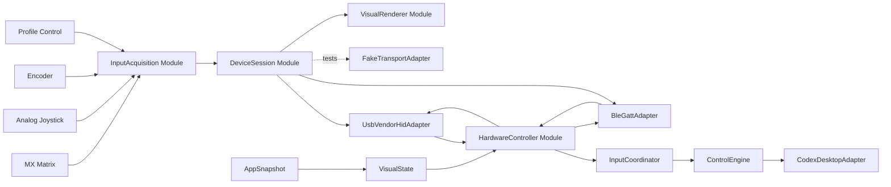

# Agent Bridge 硬件详细设计与技术实现方案

> 文档状态：Architecture Baseline v0.3（H1 验证基线，Rev A 尚未冻结）
> 日期：2026-08-03
> 目标：1–5 台自用样机，设计达到可小批量生产
> 主机平台：macOS 13+、Apple Silicon
> 固件平台：ESP32-S3 + ESP-IDF
> 电子设计：KiCad，4 层 PCB
> 机械设计：3D 打印外壳，STEP + STL/3MF
> 系统与硬件权威：本文件优先于早期 USB-only 硬件草案
> 阶段权威：[AGENT\_BRIDGE\_HARDWARE\_STAGE\_TARGETS.md](./AGENT_BRIDGE_HARDWARE_STAGE_TARGETS.md)
> Wire 协议权威：[AGENT\_BRIDGE\_PROTOCOL\_V1.md](./AGENT_BRIDGE_PROTOCOL_V1.md)

## 1. 目标和成功标准

z本方案把当前已经完成的 Agent Bridge macOS 软件控制面接入一台独立设计的实体控制器。实体设备对齐 Codex Micro 的核心功能和控件拓扑，但不要求外壳、材料、尺寸或内部结构 1:1 复刻。

完整闭环为：

```text
实体按键 / 摇杆 / 旋钮
        ↓
Agent Bridge 固件
        ↓ USB Vendor HID / BLE GATT
Agent Bridge macOS App
        ↓ 现有 typed input seam
ControlEngine
        ↓
CodexDesktopAdapter
        ↓
ChatGPT Desktop

ChatGPT 状态
        ↓
Agent Bridge App
        ↓ USB / BLE
六个 Agent Key、Mic、连接和环境灯
```

只有下列条件全部成立，才能称为“完整 Agent Bridge 自用样机”：

1. 6 个 Agent Key、7 个 Action 开关、双轴模拟摇杆和带按压旋钮全部可用。
2. 默认双宽 Mic 可以合并工作，也能切换为两个独立 Command Key。
3. USB-C 和蓝牙均能完成双向输入、状态回传和健康检查。
4. 支持 USB、蓝牙 1、蓝牙 2、蓝牙 3 四个显式连接模式。
5. 六个 Agent Key 在 1 秒内反映 ChatGPT 的状态和选中状态。
6. Mic 的录音、处理、锁定和停止状态有对应灯效。
7. 设备只发送物理语义事件，不发送键盘快捷键，不保存 ChatGPT 配置。
8. 断线、重启、睡眠和换主机不会重放旧输入，也不会留下卡住的保持状态。
9. 内置锂电池、USB-C 充电、可见电量和低功耗策略通过实测。
10. 固件可以通过 USB-C 显式升级；失败可回滚，严重故障可通过 Recovery 路径恢复。
11. PCB、BOM、Gerber、坐标、固件、CAD、打印文件和装配说明全部可重复生成。
12. 当前虚拟 UI 和现有软件测试不回归。

上述是 Rev B 最终自用版本的产品级成功标准，不等同于 H0/H1/Rev A 的阶段完成定义。各阶段实物形态和退出门槛以[硬件阶段目标文档](./AGENT_BRIDGE_HARDWARE_STAGE_TARGETS.md)为准。

## 2. 已冻结的产品决策

| ID     | 决策                                                                                       |
| ------ | ---------------------------------------------------------------------------------------- |
| HW-D01 | 功能、控件数量、布局拓扑、手势和状态反馈对齐 Codex Micro；不做外观和尺寸 1:1 复刻                                        |
| HW-D02 | 最终连接方式为 USB-C + Bluetooth Low Energy，不加入 Wi‑Fi                                           |
| HW-D03 | 内置单节可充电锂聚合物电池，USB-C 同时承担供电、充电和有线数据                                                       |
| HW-D04 | 支持 USB、蓝牙 1、蓝牙 2、蓝牙 3 四种显式模式；插线不自动抢占蓝牙                                                   |
| HW-D05 | 三个蓝牙槽位分别保存绑定，Profile 键负责选择和清除当前槽位                                                        |
| HW-D06 | 设备必须配合 Agent Bridge App；不提供普通键盘或宏键盘降级模式                                                  |
| HW-D07 | USB 使用 Vendor-defined HID；蓝牙使用 App 管理的自定义 GATT                                           |
| HW-D08 | 不暴露标准 USB/BLE Keyboard Service                                                           |
| HW-D09 | 不加入屏幕、板载麦克风、扬声器、震动马达、电机旋钮和磁吸扩展模块                                                         |
| HW-D10 | 13 个 MX 开关全部热插拔，并配置独立 RGB                                                                |
| HW-D11 | 使用真正的双轴模拟摇杆；不使用摇杆按压功能                                                                    |
| HW-D12 | Profile 使用独立低矮机械按键和 3 个白色指示灯                                                             |
| HW-D13 | 正式主控为 ESP32-S3-WROOM-1-N8R8；H0/H1 使用同平台 DevKitC                                          |
| HW-D14 | 目标电池容量约 2000–2500mAh，目标典型使用不少于 24 小时、待机不少于 14 天                                          |
| HW-D15 | 固件只有一个 Agent Bridge 控制层，不保存宏、快捷键或额外 Layer                                                |
| HW-D16 | 完整支持 Composer Navigation、Reasoning Only、Conversation Scrolling、Custom Assignments 四种旋钮模式 |
| HW-D17 | 默认合并 ACT10/ACT11；设置允许切换为两个独立 Command Key                                                 |
| HW-D18 | 支持 Push-to-talk 和 Voice Chat 两种 Mic 模式；手势由 ChatGPT 原生 Handler 处理                         |
| HW-D19 | 固件只通过 USB-C 升级，不做 BLE OTA                                                                |
| HW-D20 | 正式固件包签名、校验硬件修订、支持回滚和防止普通升级路径降级                                                           |
| HW-D21 | 固件使用 ESP-IDF，不使用 Arduino Core                                                            |
| HW-D22 | PCB 使用 KiCad；H1 电源以 FunModularKeyboard 主板 V1.2 为验证基线，但 Agent Bridge 独立完成原理图、布局和测试        |
| HW-D23 | 本阶段外壳目标为高质量 3D 打印，不做注塑或 CNC 量产结构                                                         |
| HW-D24 | 输出默认键帽、完整可更换 Keycap 套装和收纳托盘                                                              |
| HW-D25 | 首期为 1–5 台自用样机，无预算上限，但避免没有收益的奢侈器件                                                         |
| HW-D26 | 电子贴片尽量由板厂完成；用户具备基本焊接、万用表和刷写条件                                                            |
| HW-D27 | 用户可以提供多台 Mac 完成三主机蓝牙验收                                                                   |
| HW-D28 | 使用后部滑动硬电源开关和隐藏 Recovery 键                                                                |
| HW-D29 | 首次连接必须经过 App 操作和实体 Profile 键确认，不能仅凭 VID/PID 或 UUID 信任设备                                  |
| HW-D30 | 外观基线为石墨深灰机身、乳白透光 Agent Key、深色 Command Key 和克制的环境底灯                                       |
| HW-D31 | TP4056X/MT3608/ME6217/AO3401A 是 H1 基线器件；只有通过 H1 电源 Gate 后才允许原样进入 Rev A，否则必须形成 ECO 或替换方案  |
| HW-D32 | USB-C 的 A6/B6 必须在接口附近汇合为 D+，A7/B7 汇合为 D-，统一连接 ESP32-S3 原生 USB；不继承参考板的正反面数据分流或 CH340C |
| HW-D33 | USB 直供和电池 Boost 分别使用独立肖特基路径汇入 `V5_SYS`；H1 基线为两颗 SS34，禁止未经隔离并联两个电源输出                 |
| HW-D34 | `VLED` 保持 5V Rail；AO3401A 必须由 5V 参考的开漏级驱动，不能由 3.3V GPIO 直接驱动栅极                               |
| HW-D35 | Rev A 保持 13 键 4×4 矩阵、5V RGB、USB ESD 和 4 层 PCB；不继承参考板的 16 键 5×4、3.3V 全灯或 2 层板实现               |
| HW-D36 | 正式主控继续使用 ESP32-S3-WROOM-1-N8R8；ESP32-S3-MINI-1 只在 WROOM 造成已证实的结构阻断时作为独立 ECO 评估             |
| HW-D37 | 可借鉴参考板的轴座、反贴 RGB 和矩阵二极管相对布局，但封装必须依据器件数据手册和实物样品独立建立并通过 3D/装配验证               |

视觉与集成形态见[硬件阶段目标与最终形态](./AGENT_BRIDGE_HARDWARE_STAGE_TARGETS.md)及[Rev B 概念图](./assets/hardware-stages/rev-b-daily-use-final.jpg)。概念图只冻结视觉方向，最终尺寸以 KiCad、器件 3D 模型和公差试件为准。

## 3. 范围

### 3.1 本期必须实现

- 6 个 Agent 位置：`AG00`–`AG05`。
- 7 个物理 Action 位置：`ACT06`–`ACT12`。
- 1 个双轴模拟摇杆。
- 1 个机械增量编码器，支持旋转、按下和释放。
- 1 个 Profile 机械键。
- 3 个蓝牙 Profile 指示灯。
- 13 个按键位置的独立 RGB。
- 环境底灯。
- USB Vendor HID 双向协议。
- BLE 自定义 GATT 双向协议。
- 设备绑定、心跳、热插拔、断线清理和健康状态。
- 电池、充电、电池电压估算、低功耗和灯光功率限制。
- USB 固件升级、签名验证、回滚和 Recovery。
- macOS 设备设置、诊断、校准和固件升级 UI。
- KiCad、ESP-IDF、CAD、打印、装配和测试交付物。

### 3.2 明确不实现

- 普通键盘扫描码。
- 任意系统宏和脱离 App 的按键配置。
- Wi‑Fi、TCP Server、云端账号和设备遥测。
- 屏幕、音频输入、音频输出、震动、电机和扩展模块。
- BLE OTA。
- Windows/Linux Agent Bridge App。
- 注塑、CNC 铝壳和商业销售认证。
- 多台 Agent Bridge 控制器同时产生输入；首版只允许一个 Active Device。

## 4. 控件和机械拓扑

标准键距为 19.05mm。布局拓扑固定如下：

```text
┌────────────┬────────────┬────────────┬────────────┐
│ Encoder    │ AG00       │ AG01       │ Joystick   │
├────────────┼────────────┼────────────┼────────────┤
│ AG02       │ AG03       │ AG04       │ AG05       │
├────────────┼────────────┼────────────┼────────────┤
│ ACT06      │ ACT07      │ ACT08      │ ACT09      │
├────────────┼─────────────────────────┼────────────┤
│ Profile +  │ ACT10 + ACT11           │ ACT12      │
│ 3 LEDs     │ default 2U Mic keycap   │            │
└────────────┴─────────────────────────┴────────────┘
```

物理开关总数：

- Agent：6 个 MX。
- Action：7 个 MX。
- Profile：1 个独立低矮机械开关。
- Encoder：1 个旋转编码器内置按压开关。

默认 2U Mic 键帽覆盖 ACT10 和 ACT11 两个 MX 开关。固件始终独立上报两个物理位置，是否合并由桌面 App 的 `CommandPairResolver` 决定。

## 5. 系统架构与 Module



### 5.1 固件 Module

| Module             | Interface                             | 隐藏的 Implementation                  |
| ------------------ | ------------------------------------- | ----------------------------------- |
| `InputAcquisition` | 输出有界 `PhysicalEvent` 流和当前输入快照         | 矩阵扫描、消抖、ADC、滤波、编码器计数和 Profile 本地行为  |
| `DeviceSession`    | 接收 Transport 帧、输出事件/状态、接受 VisualState | 握手、序号、绑定、心跳、Snapshot、自愈和错误状态        |
| `Transport` seam   | `start/stop/send/receive/mtu/state`   | USB HID、BLE GATT、测试 Fake 三个 Adapter |
| `VisualRenderer`   | 接受全量语义状态和电源预算                         | RGB 映射、动画、自动熄灯、Profile 指示和离线表现      |
| `PowerManager`     | 电池电压、充电状态、电源来源、功率级别                   | ADC 电压估算、充电状态、LED Rail、休眠和唤醒        |
| `FirmwareUpdate`   | 开始、写块、校验、提交、回滚状态                      | OTA 分区、签名、版本检查、Flash 写入和恢复          |

`DeviceSession` 是固件最深的 Module。输入、传输、信任和断线复杂度都留在其 Implementation 中，调用方只看到有界事件和全量状态。

### 5.2 macOS Module

新增一个深 `HardwareController` Module，Interface 控制在四项：

```rust
trait HardwareController {
    fn start(&self) -> HardwareEventStream;
    async fn publish_visual_state(&self, state: HardwareVisualState);
    async fn execute_device_command(&self, command: DeviceCommand)
        -> DeviceCommandResult;
    fn snapshot(&self) -> HardwareSnapshot;
}
```

它的 Implementation 隐藏：

- IOKit 枚举和热插拔。
- CoreBluetooth 扫描、连接和权限。
- USB/BLE Transport Adapter。
- 协议编解码、BLE 分片和重组。
- 设备绑定、Keychain、心跳、重连和 Active Device 选择。
- 固件升级传输。

React、`ControlEngine` 和 `CodexDesktopAdapter` 不接触原始 USB/BLE 数据。

## 6. 电子硬件设计

### 6.1 主控

正式 PCB 使用 `ESP32-S3-WROOM-1-N8R8`：

- 8MB Flash。
- 8MB Octal PSRAM。
- 原生 USB 2.0 Full-Speed。
- Bluetooth Low Energy。
- 模组内置天线和射频匹配。

H0/H1 使用 `ESP32-S3-DevKitC-1-N8R8`，确保台架和正式板使用相同 MCU、Flash/PSRAM 和 USB 控制器。H1 仍是开发板台架，不把 DevKitC 视为 Rev A 主板的一部分。

官方资料：

- [ESP32-S3-WROOM-1 数据手册](https://www.espressif.com/sites/default/files/documentation/esp32-s3-wroom-1_wroom-1u_datasheet_en.pdf)
- [ESP-IDF USB Device Stack](https://docs.espressif.com/projects/esp-idf/en/stable/esp32s3/api-reference/peripherals/usb_device.html)

硬约束：

- GPIO19 固定 USB D-。
- GPIO20 固定 USB D+。
- 模组天线必须靠 PCB 边缘。
- 天线正下方和前方保持无铜、无电池、无金属定位板区域。
- USB 业务运行时不复用 USB Serial/JTAG PHY。
- 调试优先走独立 UART/JTAG 测试点。

### 6.2 USB-C

首选 USB 2.0 Type-C 16-pin receptacle，不支持 USB-PD：

- CC1、CC2 各使用 5.1kΩ Rd。
- 连接器 A6 与 B6 在接口附近、总分叉尽量不超过 3.5mm 的范围内汇合为 D+；A7 与 B7 同样汇合为 D-。
- 汇合后的 D+/D- 直接连接 GPIO20/GPIO19，不得把两个插头方向分别分配给 ESP32 和另一个 USB/UART 芯片。
- 引脚连接和走线约束以 [USB Type-C Cable and Connector Specification Release 2.5](https://www.usb.org/document-library/usb-type-cr-cable-and-connector-specification-release-25) 为准。
- 使用低电容 USB ESD 阵列，例如 `USBLC6-2SC6`。
- D+/D- 目标差分阻抗 90Ω。
- 差分对尽量不换层、不分叉、不经过测试点。
- VBUS 同时进入 TP4056X 充电输入、经过已验证开关/隔离路径的 `V5_SYS`，以及电压安全的 `VBUS_SENSE`；不得把 USB 5V 与另一个稳压器输出未经隔离直接并联。
- 连接器固定脚和外壳焊盘承受插拔力，不让信号焊盘承担机械应力。

USB Interface 只暴露 Vendor-defined HID，不暴露 Keyboard、Mouse、CDC 或 Mass Storage。

开发 VID/PID 只允许用于自用样机，并在描述符中标记 development。正式分发前必须替换为合法分配的 VID/PID。

### 6.3 按键矩阵

13 个 MX 开关采用 4×4 二极管矩阵：

- 每个开关串联 `1N4148W/1N4148WS`。
- 4 Row + 4 Column，共 8 个 GPIO。
- 未使用矩阵位置在原理图和固件表中显式标记 absent。
- 使用 Kailh MX 热插拔轴座 `CPG151101S11` 或兼容、经样品验证的轴座。
- Rev A 可借鉴 FunModularKeyboard 的“轴座、反贴 RGB、矩阵二极管”按键单元相对布局，但保持 13 键 4×4 电气拓扑；封装尺寸和 PCB 开孔必须依据数据手册、轴座/RGB 样品和下壳净空独立验证，不直接导入参考工程库。
- 矩阵扫描周期目标 1ms。
- 消抖使用每键积分或状态机，目标 8–12ms。
- 固件不合成 click、double-click 或 long-press。

机械双击和长按时间完全交给 ChatGPT 原生 Handler，固件只及时上报 Pressed/Released。

### 6.4 模拟摇杆

电气要求：

- 两路线性模拟输出，中心回弹。
- 供电 3.3V。
- 每轴增加 RC 抗噪滤波。
- ADC 输入增加 ESD/限流保护。
- 不使用摇杆按压触点。

算法：

1. 首次校准采集中心和四方向最大值。
2. 保存中心、轴向比例、反向标志和温漂余量。
3. 采样目标 250–500Hz。
4. 使用中值 + 一阶低通滤波。
5. 中心死区和方向进入阈值分离，形成滞回。
6. 对角输入按角度分成四个扇区，而不是简单比较单次 ADC。
7. 方向变化先发送旧方向 Centered，再发送新方向 Entered。

最终摇杆料号不能仅靠数据表决定，必须比较至少两种实物的中心漂移、手感、高度和寿命。

**\[USER-PHYSICAL]** 用户负责购买候选摇杆并反馈实测手感；我负责测试固件、数据采集、阈值分析和最终电路/封装冻结。

### 6.5 编码器

使用带按压的 EC11 类机械增量编码器：

- 有机械档位。
- A/B 两相进入 GPIO，使用 PCNT 或中断 + Gray Code 状态机。
- 按压开关单独消抖并产生 Pressed/Released。
- 每个机械档位严格生成一个有符号 step。
- 旋转与按压可以同时发生，固件不自行判断短按或长按。
- 正方向在 H0 上通过实际旋钮安装方向冻结。

具体轴高、轴型和旋钮配合在 CAD 第一版完成后冻结。

**\[USER-PHYSICAL]** 用户负责确认最终旋钮直径、高度和阻尼手感。

### 6.6 Profile 控件

- 一个独立低矮 SMD 机械按键。
- 三个 0603 白色 LED。
- 短按进入/移动连接选择。
- 长按 3 秒进入当前蓝牙槽位重新绑定。
- 首次设备信任绑定期间，长按用于确认物理在场。
- 清除绑定必须通过明确的长按和警示灯效，不能单击误触发。

连接模式：

| 模式  | 行为                         |
| --- | -------------------------- |
| USB | USB Vendor HID 启用；BLE 业务关闭 |
| BT1 | 连接/广播蓝牙槽位 1；USB 只供电和充电     |
| BT2 | 连接/广播蓝牙槽位 2；USB 只供电和充电     |
| BT3 | 连接/广播蓝牙槽位 3；USB 只供电和充电     |

当前模式保存到 NVS，重启恢复。插入 USB-C 不自动修改模式。

### 6.7 RGB

- H0 使用一条 WS2812B 8位 RGB 开发板验证最小 VisualState 回路；开发板以 5V 供电，数据经 `74AHCT125N` 从 3.3V 转为 5V，首灯前串联 220–470Ω，并以固件限制约 20%–30% 亮度。
- 13 个按键位置各放置一个 `SK6812MINI-E` 或经验证兼容的下灯位 RGB。
- 双宽 Mic 下两个 RGB 始终同步渲染。
- 建议 8–12 个底部环境 RGB，最终数量由 PCB 外形和扩散测试决定。
- RGB 使用独立、可关断的 `VLED` Rail。
- H1 台架可使用便于插接的 `74AHCT125N` DIP；Rev A 候选为更小的 `74AHCT1G125`，两者都必须按实际 `VLED` 电压验证高电平裕量。
- `VLED` 继续由名义 5V 的 `V5_SYS` 供电，不照搬参考板的 3.3V 全灯 Rail；13 个按键 RGB 与 8–12 个底灯不得全部压在 ME6217 的 3.3V 输出上。
- AO3401A 作为 P-MOS 高边开关时，源极接 `V5_SYS`、漏极接 `VLED`，栅极由 2N7002 或等价开漏级下拉；栅源间使用 5V 上拉保证默认关断。初始控制网络为 GPIO→1kΩ→2N7002 Gate、Gate→100kΩ→GND、AO3401A Gate→100kΩ→`V5_SYS`，最终值由 H1 上电默认状态和开关波形确认。
- 数据首端串联约 220–470Ω 电阻。
- H1 比较 220µF、470µF、1000µF 和 1200µF 候选样品对浪涌、压降和启动的影响；电容必须低 ESR、额定电压不低于 `6.3V`。Rev A 预留经实物确认的可选 Bulk 位置，最终容量和是否装配由 H1 波形决定；每颗 RGB 旁仍保留本地去耦。
- 固件设置总亮度和估算电流上限，不允许所有灯长期满白。

每个 LED 理论峰值必须进入最坏情况预算，但产品正常模式按固件限流设计：

- 电池模式建议 RGB 总预算不超过 400–500mA。
- USB 模式建议 RGB 总预算不超过 800–900mA。
- 最终值必须按 LED 样品、电源温升和 USB 输入限制测量后冻结。

### 6.8 电池、充电和电源路径

H1 先直接使用 FunModularKeyboard 主板 V1.2 派生电源树作为验证基线。只有本节 Gate 全部通过后，Rev A 才允许集成同一拓扑和器件；H1 失败时必须先形成电源 ECO，不能为了保持参考工程一致而跳过整改。

```text
USB-C VBUS ──→ ESD / Fuse / Input Protection ──→ TP4056X ──→ BAT+ ──→ 1S LiPo + PCM
      │                                                   │
      └── SW1A ──→ SS34 (D_USB) ─────────────────────→ V5_SYS
                                                          ↑
BAT+ ── SW1B ──→ MT3608 + 4.7µH + SS34 (D_BOOST) ───────┘

V5_SYS ──→ ME6217C33M5G ──→ V3V3
V5_SYS ──→ AO3401A 高边开关 ──→ VLED
                    ↑ Gate：V5_SYS 上拉 + 2N7002 开漏下拉
BAT+ ──→ 1MΩ/1MΩ + 100nF ──→ BAT_SENSE / ESP32 ADC
VBUS ──→ 电压安全检测 ──→ VBUS_SENSE
TP4056X CHRG/STDBY ──→ 电压安全检测 ──→ CHRG_N/STDBY_N
```

基线器件：

| 功能              | H1 首选器件                     | 参考工程标识      | 用途/初始值                 |
| --------------- | --------------------------- | ----------- | ---------------------- |
| 单节锂电充电          | TOPPOWER `TP4056X-42-ESOP8` | `C2763448`  | `PROG=1.2kΩ`，参考电流约 1A  |
| 电池 Boost        | `MT3608`                    | `C84817`    | `16kΩ/2.2kΩ` 反馈，输出必须实测 |
| Boost 整流二极管     | `SS34`                      | `C47018524` | `D_BOOST`，MT3608 功率级整流并承载实际峰值电流 |
| USB 供电隔离二极管    | `SS34`                      | `C47018524` | `D_USB`，阻止 `V5_SYS` 向 USB VBUS 反灌      |
| Boost 电感        | `CDRH74NP-4R7MT`，4.7µH      | `C47021195` | 饱和电流和温升必须实测            |
| 3.3V Rail       | `ME6217C33M5G`              | `C427602`   | 从 `V5_SYS` 线性降至 `V3V3` |
| 双联电源开关          | `MSS22D18G2 125`            | `C2906278`  | 联动 USB 直供与电池 Boost 路径  |
| RGB Load Switch | `AO3401A`                   | `C15127`    | 5V P-MOS 高边开关            |
| RGB Gate Driver | `2N7002` 或等价小信号 NMOS       | —           | 5V 上拉、开漏下拉，默认关闭 `VLED`  |
| 电池连接器           | `HC-1.25-2PWT`，2-pin        | `C2845379`  | 极性以实物线束复核              |
| 电池电压估算          | 1MΩ/1MΩ + 100nF ADC 分压      | —           | 低成本估算，不使用独立 Fuel Gauge |
| 充电/Profile 指示   | `NCD0603R1`                 | `C84263`    | 参考 LED，电阻值按 Rail 与亮度复核 |
| USB ESD         | `USBLC6-2SC6` 或同级低电容器件      | —           | 保护 D+/D-               |

器件依据：[FunModularKeyboard 主板 V1.2 EasyEDA Pro 工程](../reference/FunModularKeyboard/electronics/MainBoard/ProPrj_FunModularKeyboard_Main_V1.2_2026-07-18.epro2)。

参考仓库采用 AGPL-3.0。本项目只把其拓扑和布局经验作为验证输入；Agent Bridge 的原理图、PCB、符号和封装均依据原厂数据手册与实物样品独立绘制。若以后要直接导入或分发参考工程资产，必须先单独完成许可证审查。

该方案明确接受以下限制：没有动态 PowerPath、没有电池 NTC、没有独立 Fuel Gauge；USB 供电和电池 Boost 通过双联开关及肖特基路径近似组合，它不是自动电源优先级、限流或无缝切换控制器。主板不承担电芯过放、过流和短路保护，必须使用自带 PCM 保护板的电池。电量百分比只能由电压曲线估算，App 必须标明为近似值。

H1 实现约束：

- MT3608、`D_BOOST`、`D_USB`、电感及其输入/输出电容必须位于专用 H1 电源小 PCB 上，严格缩短高 `di/dt` 回路；不得用长杜邦线或面包板代替。
- `V5_SYS` 是名义系统 Rail，不先假定肖特基后的实际值恰好为 5.00V；必须记录 USB 供电、电池满电和电池低电量时的电压、纹波、启动浪涌和负载阶跃。
- [ESP32-S3-DevKitC-1 官方指南](https://docs.espressif.com/projects/esp-dev-kits/en/latest/esp32s3/esp32-s3-devkitc-1/user_guide_v1.0.html)将 USB、5V/GND 和 3V3/GND 定义为互斥供电选项。H1 必须在接线图中冻结唯一注入方式并隔离其他来源；不得把 ME6217 输出与 DevKit 板载 LDO 输出并联。若 USB 只承载数据，必须使用明确切断 VBUS 的数据路径，而不是依赖线材碰运气。
- H1 必须分别验证 MT3608/`D_BOOST`/电感的峰值与持续负载能力、`D_USB` 的压降和反灌、ME6217 在 ESP32 峰值电流下的压降/温升，以及全灯受限模式下是否触发 Brownout。任一项不通过即阻止 Rev A 沿用。
- 1MΩ/1MΩ 是高源阻抗 ADC 分压，100nF 用于形成采样储能/滤波；固件必须留采样稳定时间、使用多次采样和校准曲线。参考工程的 GPIO4 不能直接照抄，`BAT_SENSE` 只能在完整 GPIO 冲突表通过后分配。
- TP4056X 的 ESOP 散热焊盘、铜皮和周围温升按约 1A 初始值设计；最终充电电流要由电池规格、最差输入/电池压差、开机负载和壳内温升共同决定。
- `VLED` 高边开关必须验证上电和复位期间默认关闭、GPIO 高电平时完全导通、GPIO 低电平或高阻时完全关断；不得接受 3.3V GPIO 直接驱动 5V P-MOS Gate 的接法。
- `VLED` Bulk 从 220/470/1000/1200µF 候选中实测选择；最终值不能替代每颗 RGB 的本地去耦，也不能替代固件电流上限。

ABP v1 电源状态映射：

| ABP v1 字段                    | 硬件来源                      | 规则                                                               |
| ---------------------------- | ------------------------- | ---------------------------------------------------------------- |
| `battery percent`            | `BAT_SENSE`               | 校准电压曲线估算 `0..100`；ADC/电池状态不可用时发送 `255=unknown`                   |
| `power flags.charging`       | `CHRG_N`（必要时结合 `STDBY_N`） | TP4056X 状态脚必须经过 3.3V 安全的上拉/调理；不得把由 VBUS 驱动的 LED 节点直接接 ESP32 GPIO |
| `power flags.external power` | `VBUS_SENSE`              | 反映 USB VBUS 存在，不等同于系统一定由 USB 独占供电                                |
| `power flags.low battery`    | `BAT_SENSE`               | 使用经 H1 实测冻结的阈值和迟滞，避免临界电压反复跳变                                     |

充电参数初始值：

- 参考值为 1.2kΩ PROG、约 1A；H1 首次上电使用限流电源，并确认实际充电电流、热调节和终止电流。
- 必须使用自带 PCM、允许充电电流不低于 1A 的正规单节 LiPo。
- 充电时可以正常运行，但不能把它描述为受控 PowerPath；H1 必须分别记录关机、开机轻载、典型工作负载和接近满电状态下的充电电流、CHRG/STDBY 行为与温升。若出现无法终止、反复终止/重充、超过电池或器件限制，Rev A 必须改用带动态 PowerPath 的充电方案。
- USB 插入时优先把 RGB 预算限制在验证值内；H1 必须验证插拔 USB 及切换电源开关时无反向灌电、无不可接受 Rail 冲突，且系统行为与 Connection Mode 独立。
- 主电源滑动开关关闭时，电池仍可充电，主系统和 RGB 不启动。
- 初次电池充电和满载测试使用限流电源、防火容器或金属/陶瓷托盘并持续测温；先关 RGB 轻载验证，再逐级增加负载。

**\[USER-PHYSICAL]** 用户负责购买正规电池样品、检查尺寸/保护板/极性，并完成关机/开机充电温升和续航实测；我负责电路、参数、测试步骤和数据分析。

### 6.9 调试、Recovery 和测试点

必须暴露：

- UART TX/RX/GND。
- JTAG 或 Tag-Connect 测试点。
- EN、BOOT、V3V3、VBUS、BAT、V5\_SYS、VLED、VBUS\_SENSE、BAT\_SENSE、CHRG\_N、STDBY\_N。
- 矩阵 Row/Column。
- Joystick X/Y。
- I²C SDA/SCL。
- Profile 按键。

Recovery：

- 外壳隐藏孔可触发 BOOT/Recovery。
- 正常升级通过运行中固件写入非活动 OTA 分区。
- 正常升级失败由 Bootloader 回滚。
- Factory Recovery App 保持只读、只接受签名镜像。
- 如果 Secure Boot/Flash Encryption 已烧录，ROM USB-OTG DFU 不能作为唯一救援路径；ESP-IDF 官方明确说明安全特性会禁用该 ROM USB-OTG 更新路径。
- 极端故障通过 UART/JTAG 测试点恢复。

安全 eFuse 只在 H1 和恢复流程全部验证后启用；H0 和早期 Rev A 不烧不可逆 eFuse。

## 7. PCB 设计

### 7.1 层叠

正式板使用 4 层：

| 层  | 用途                      |
| -- | ----------------------- |
| L1 | 主器件、USB、关键高速和短模拟信号      |
| L2 | 连续 GND Plane            |
| L3 | V3V3、V5\_SYS、VLED 和低速信号 |
| L4 | 热插拔轴座、RGB、矩阵和底灯         |

### 7.2 关键布局

- WROOM 天线朝外，按模组数据手册留完整 keepout。
- 电池不得覆盖天线区域。
- 保持四层板；只借鉴 FunModularKeyboard 的 USB/充电/Boost 集中、MCU 天线靠板边和按键区分离的功能分区，不继承其两层叠层。
- USB D+/D- 靠近接口和 MCU，远离 MT3608 SW Node 与 RGB 数据/开关边沿。
- MT3608 Boost、TP4056X 充电和 ME6217 LDO 回路严格按数据手册最小热环路布局。
- Joystick ADC 远离 LED Data、Boost SW Node 和 USB。
- 充电 IC、Battery Boost、3.3V LDO 和 RGB Load Switch 分区布置并留足热扩散铜。
- 热插拔轴座位于 PCB 背面，避免与电池和电源器件冲突。
- 电池下方不放尖锐通孔和高器件。
- 所有螺丝孔设置铜禁布区。

### 7.3 ERC/DRC Gate

进入打板前必须：

1. ERC 无未解释错误。
2. DRC 无未解释错误。
3. USB 差分阻抗和间距由板厂叠层回填。
4. 天线 keepout 通过 2D/3D 检查。
5. 关键电源器件按官方 Layout Guide 对照。
6. 连接器、轴座、摇杆、编码器、电池完成 3D 干涉检查。
7. 输出 Gerber 后使用独立 Viewer 复核。
8. BOM 中每个关键器件至少有一个可接受替代料或明确禁止替代。

## 8. Rev A 候选 BOM

本表是 Rev A 的条件候选，不是 H1 验证前的采购冻结。H0/H1 的台架件、功率测试小板和最终 Rev A 贴片件按阶段分别采购；H1 已使用过的验证件默认不拆下复用到 Rev A。

| 类别                | 型号/规格                                           |   数量 | 状态                           |
| ----------------- | ----------------------------------------------- | ---: | ---------------------------- |
| MCU               | ESP32-S3-WROOM-1-N8R8                           |    1 | 冻结                           |
| MX 轴座             | Kailh CPG151101S11 或验证兼容                        |   13 | 样品确认                         |
| MX 轴体             | 标准 MX 兼容                                        |   13 | 用户选择手感                       |
| Matrix Diode      | 1N4148W/WS                                      |   13 | 冻结                           |
| Key RGB           | SK6812MINI-E                                    |   13 | 样品和亮度确认                      |
| Underglow RGB     | SK6812MINI-E/兼容                                 | 8–12 | PCB 外形后冻结                    |
| RGB Level Shift   | H0/H1：74AHCT125N DIP；Rev A：74AHCT1G125          |    1 | H0 先验证链路，H1 再完成电平/波形冻结         |
| LED Rail Bulk     | 220–1200µF 候选、低 ESR、≥6.3V                       |  0–1 | H1 浪涌/纹波后冻结是否装配、容量与封装        |
| Encoder           | EC11E15244G1 或经 H1 验证的 EC11 类，带按压               |    1 | 轴高/阻尼待实物                     |
| Joystick          | 候选：标准 PS2 游戏双轴摇杆模块 / ALPS RKJXV1220001    |    1 | **\[USER-PHYSICAL]** H1 样品比较 |
| Profile Switch    | 低矮 SMD 机械开关                                     |    1 | CAD 后冻结                      |
| Profile LED       | 0603 White                                      |    3 | 冻结                           |
| USB-C             | USB 2.0 Type-C 16-pin                           |    1 | 封装样品确认                       |
| USB ESD           | USBLC6-2SC6/同级                                  |    1 | 冻结                           |
| Charger           | TOPPOWER TP4056X-42-ESOP8（C2763448）             |    1 | H1 充电/终止/温升后冻结               |
| 5V Boost          | MT3608（C84817）                                  |    1 | H1 功率预算后冻结                   |
| Boost Diode       | SS34（C47018524），`D_BOOST`                       |    1 | H1 压降/温升后冻结                  |
| USB Isolation Diode | SS34（C47018524），`D_USB`                       |    1 | H1 压降/反灌后冻结                  |
| Boost Inductor    | CDRH74NP-4R7MT 4.7µH（C47021195）                 |    1 | H1 饱和/温升后冻结                  |
| 3.3V LDO          | ME6217C33M5G（C427602）                           |    1 | H1 ESP32 负载阶跃后冻结             |
| LED Load Switch   | AO3401A（C15127）                                 |    1 | H1 关断/压降后冻结                  |
| LED Gate Driver   | 2N7002/等价 NMOS + 5V 上拉与 GPIO 下拉网络              |  1 组 | H1 默认关断/波形后冻结                |
| Battery Sense     | 1MΩ/1MΩ + 100nF ADC 分压                          |  1 组 | ADC 校准后冻结                    |
| Battery           | 1S 2000–2500mAh，自带 PCM、两线                       |    1 | **\[USER-PHYSICAL]** 尺寸和样品待定 |
| Battery Connector | HC-1.25-2PWT，2-pin（C2845379）                    |    1 | 电池样品极性后冻结                    |
| Power Switch      | MSS22D18G2 125（C2906278）                        |    1 | H1 切换和 CAD 后冻结               |
| Recovery Switch   | 隐藏式按键                                           |    1 | 冻结                           |
| Fasteners         | M2.5 螺丝 + 热熔铜螺母                                 |  4–6 | 结构后冻结                        |
| Feet              | 硅胶脚垫或 TPU                                       |    4 | 结构后冻结                        |

PCB 下单前要基于目标板厂和供应商库存重新执行一次 Lifecycle、封装和替代料审查。候选型号不是跳过样品验证的授权。

## 9. 固件设计

### 9.1 工程结构

建议新增独立项目：

```text
firmware/
  CMakeLists.txt
  sdkconfig.defaults
  partitions.csv
  components/
    ab_protocol/
    board_support/
    device_identity/
    device_session/
    input_matrix/
    input_joystick/
    input_encoder/
    profile_control/
    transport_usb/
    transport_ble/
    visual_renderer/
    power_manager/
    firmware_update/
    diagnostics/
  main/
  test/
  tools/
```

不使用 Arduino Core，不把所有逻辑写入一个 `main.cpp`。

### 9.2 FreeRTOS 任务

| 任务                | 建议优先级 | 周期/触发           | 责任                 |
| ----------------- | ----: | --------------- | ------------------ |
| Input Scan        |     高 | 1ms             | Matrix 扫描和消抖       |
| Joystick          |     高 | 2–4ms           | ADC、滤波、方向状态机       |
| Encoder           |     高 | 中断/PCNT + queue | 旋转和按压边沿            |
| Device Session    |     高 | Event-driven    | 协议、序号、绑定、Snapshot  |
| USB/BLE Transport |     高 | Event-driven    | 收发和连接状态            |
| Visual            |     中 | 16–25ms         | 本地灯效帧              |
| Power             |     低 | 100–1000ms      | 电池、充电、功率级别         |
| Diagnostics       |     低 | Event-driven    | 有界计数和 reset reason |

规则：

- ISR 只写固定大小队列，不做协议编码和灯效。
- 输入队列固定容量；队列满时记录计数并立即发送 Snapshot。
- 启动后关键路径不做无界堆分配。
- 灯效、Flash 写入和电量查询不能阻塞输入扫描。
- 看门狗覆盖 Session、Input 和 Visual 关键任务。

### 9.3 输入语义

固件只产生：

- Agent `Pressed/Released`。
- ACT06–ACT12 `Pressed/Released`。
- Joystick `Entered/Centered`。
- EncoderPress `Pressed/Released`。
- EncoderRotate `Rotated(steps)`。

固件不产生：

- Mic、Approve、Reject 等动作名。
- click、double-click、long-press。
- ChatGPT 命令、Keycap、Skill 或线程 ID。

### 9.4 NVS

允许保存：

- Hardware revision。
- Calibration。
- 当前连接模式。
- 三个 BLE Bond Slot。
- 每 Host 信任材料。
- 灯光亮度和自动熄灯设置。
- 启动计数和升级状态。

禁止保存：

- ChatGPT 账号或任务信息。
- Command/Joystick/Encoder Binding。
- 系统快捷键。
- Wi‑Fi/API 凭据。

### 9.5 灯光状态机

主机发送全量语义状态，固件本地渲染动画：

| 状态                    | 默认表现                |
| --------------------- | ------------------- |
| Agent Empty           | 熄灭                  |
| Agent Idle            | 白色                  |
| Agent Thinking        | 蓝色                  |
| Agent Complete/Unread | 绿色                  |
| Agent Requires Input  | 琥珀色                 |
| Agent Error           | 红色                  |
| Selected Agent        | 当前状态颜色的轻微呼吸         |
| Mic Recording         | 海绿色流动环境灯            |
| Mic Processing        | 白色流动环境灯             |
| Mic Ready             | 白色常亮短暂提示            |
| Offline               | 低亮度中性呼吸，不显示最后状态为可执行 |
| Incompatible          | 明确红色错误模式，禁止输入       |
| Pairing               | 当前 Profile LED 快闪   |
| Bonded                | 当前 Profile LED 常亮   |

默认闲置 3 分钟关闭 RGB。App 可配置 30 秒到 1 小时或关闭自动熄灯。输入、Agent 状态变化或连接变化唤醒灯光。

### 9.6 低功耗

- USB 模式：不为省电牺牲输入延迟。
- BLE 活跃：使用合理连接间隔和 slave latency，输入时快速恢复。
- 灯光熄灭后关闭 `VLED`。
- 无连接时降低广播占空比，但配对模式保持可发现性。
- 休眠时矩阵/Profile/Encoder 选择可靠唤醒源。
- H1 必须获得典型续航和待机功耗的实测基线，用来决定 Rev A 是否需要电源 ECO；达到 24 小时典型使用和 14 天待机是 Rev B 最终 Gate，不以理论估算验收。

## 10. Agent Bridge Protocol v1

本节只保留硬件/系统视角的摘要。帧长度、字段、枚举、方向、状态机、Golden Packet 和非法语料的唯一实现依据是[AGENT\_BRIDGE\_PROTOCOL\_V1.md](./AGENT_BRIDGE_PROTOCOL_V1.md)；两者冲突时不得按本节猜测或扩展 Wire 格式。

### 10.1 传输

USB：

- Vendor Usage Page：开发阶段 `0xFFAB`。
- Usage：`0x0001`。
- Input Report ID：`0x01`。
- Output Report ID：`0x02`。
- Report ID 之后 63 字节应用帧。
- Interrupt interval 目标 1–4ms。

BLE：

- 128-bit Agent Bridge Service UUID，正式固件前冻结。
- Host → Device：Write / Write Without Response characteristic。
- Device → Host：Notify characteristic。
- Device Info：Read characteristic。
- 要求系统 BLE Encryption + Bonding。
- MTU 不足以容纳完整帧时，由 `BleGattAdapter` 分片；上层协议不感知分片。
- 分片重组有固定缓冲、序号、总数和 100ms 超时，不允许无界内存。

### 10.2 通用帧

所有多字节整数使用 little-endian：

| Offset | Length | Field                |
| -----: | -----: | -------------------- |
|      0 |      1 | magic=`0xAB`         |
|      1 |      1 | protocol\_major      |
|      2 |      1 | protocol\_minor      |
|      3 |      1 | message\_type        |
|      4 |      1 | flags                |
|      5 |      1 | payload\_length，0–48 |
|      6 |      4 | sequence             |
|     10 |      4 | sender\_uptime\_ms   |
|     14 |     48 | payload              |
|     62 |      1 | reserved=0           |

USB/BLE 自身都有链路校验；应用帧不增加 CRC。错误 magic、长度、版本、枚举和保留位必须 fail closed。

### 10.3 消息

Device → Host：

- `DEVICE_HELLO`
- `AUTH_RESPONSE`
- `INPUT_EVENT`
- `INPUT_SNAPSHOT`
- `DEVICE_STATUS`
- `PONG`
- `ACK`
- `PROTOCOL_ERROR`
- `UPDATE_STATUS`

Host → Device：

- `HOST_HELLO`
- `AUTH_CHALLENGE`
- `CLAIM_BEGIN`
- `CLAIM_COMMIT`
- `GET_INPUT_SNAPSHOT`
- `GET_DEVICE_STATUS`
- `VISUAL_STATE`
- `SET_DEVICE_CONFIG`
- `PING`
- `HOST_GOING_AWAY`
- `UPDATE_BEGIN`
- `UPDATE_CHUNK`
- `UPDATE_COMMIT`

### 10.4 控件 ID

| Type          | ID                         |
| ------------- | -------------------------- |
| Agent         | 0–5 = AG00–AG05            |
| Action        | 0–6 = ACT06–ACT12          |
| Joystick      | 0=Up、1=Right、2=Down、3=Left |
| EncoderPress  | 0                          |
| EncoderRotate | 0                          |

ACT10 和 ACT11 永远是不同的 Wire Control。默认合并发生在 Host，不发生在固件或协议。

### 10.5 建链

H0/Fake 的最小建链与生产 H1+ 建链分开定义：

```text
H0 / Fake minimum:
Transport Connected
  → DEVICE_HELLO
  → GET_INPUT_SNAPSHOT
  → INPUT_SNAPSHOT
  → Ready

H1+ authenticated session:
Transport Connected
  → DEVICE_HELLO
  → HOST_HELLO
  → AUTH_CHALLENGE / AUTH_RESPONSE
  → GET_INPUT_SNAPSHOT / INPUT_SNAPSHOT
  → GET_DEVICE_STATUS / DEVICE_STATUS
  → PING / PONG
  → VISUAL_STATE
  → Ready
```

Ready 之前：

- Host 不执行普通输入。
- Snapshot 中已经按下的键只被抑制到释放，不补发按下。
- 版本不兼容或认证失败进入不可执行灯效。

### 10.6 序号和断线

- Device/Host 各自维护发送方向 `u32 sequence`。
- `boot_id` 表示设备启动代次。
- 重复和倒序包丢弃。
- 序号缺口触发 Snapshot，不猜测缺失事件。
- 断线清理该来源的所有 pressed/entered 状态。
- 重连不重放。
- Host 心跳建议 2 秒；连续 3 次失败关闭连接并重新发现。
- 固件 6 秒未收到有效 Host 消息，进入 Offline 状态。

### 10.7 信任绑定

新设备默认 Unclaimed：

1. App 发现设备并显示有限元数据。
2. 用户点击绑定。
3. 设备进入 30 秒 Claim Window。
4. 用户长按 Profile 键确认物理在场。
5. Host/Device 生成临时 P-256 ECDH 密钥对并交换公钥。
6. 双方用 ECDH 共享秘密、两个随机 nonce 和设备 ID 通过 HKDF-SHA256
   派生独立的 Host 信任密钥。
7. Host 密钥进入 macOS Keychain。
8. Device 密钥进入加密 NVS 或受保护分区。
9. 临时私钥在 Claim 完成后立即清除。
10. 后续连接使用随机 nonce + HMAC-SHA256 challenge-response。

认证失败只允许重新 Claim、诊断和升级恢复，不允许输入。

BLE 同时启用 LE Secure Connections 和 Bonding；应用层认证不能替代 BLE 链路加密。
Claim Window 同一时间只接受当前 USB Session 或当前 BLE Connection 的一个
发起者，Profile 键确认只提交这个待确认会话，避免相邻进程抢占确认。

## 11. macOS 软件改动

### 11.1 数据模型

现有模型需要扩展：

- `InputSource` 增加硬件来源、设备脱敏 ID、Transport 和 Connection Generation。
- `CommandSlot` 从 6 个逻辑位置演进为 7 个物理 Action 位置。
- 增加 `CommandPairMode::Combined/Split`。
- `EncoderMode` 增加 Conversation Scrolling 和 Custom Assignments。
- Custom Encoder 保存 left/right/press/long-press Binding。
- 加入 `voiceButtonMode`。
- `AppSnapshot` 增加设备、连接、Profile、电池、充电、固件和校准状态。

### 11.2 双宽 Mic Resolver

Combined：

```text
ACT10/ACT11 active count 0 → 1：产生一次逻辑 Pressed
active count 1/2 → 0：产生一次逻辑 Released
```

Split：

- ACT10 和 ACT11 分别进入 Binding 解析。
- 虚拟 UI 同时显示两个 1U 控件。
- 物理用户需要换下 2U Mic 键帽。

### 11.3 InputCoordinator

所有来源先进入同一个 `InputCoordinator`：

- 校验来源代次和生产者序号。
- 按来源隔离 pressed 状态。
- 给规范化事件分配 App 全局 sequence。
- 相同逻辑保持型控件使用引用计数聚合。
- 断线只释放该来源的贡献。
- 虚拟 UI 和硬件共用现有 `ControlEngine`。

### 11.4 macOS Adapter

USB：

- Rust 后端使用 IOKit/IOHIDManager。
- 精确匹配 VID/PID/Usage Page/Usage。
- 句柄、Report 和 Serial 不进入 WebView。
- 最终是否触发 Input Monitoring 由实机描述符验证，不提前申请 Accessibility。

BLE：

- 使用 CoreBluetooth。
- App 内扫描、选择、绑定和连接。
- 声明 Bluetooth Usage Description。
- 只连接 Agent Bridge Service UUID。
- 处理权限拒绝、蓝牙关闭、睡眠、越界和主机切换。

### 11.5 设置和诊断

新增：

- 当前连接模式和 Profile。
- 电量、充电和固件/硬件版本。
- Bind/Forget Device。
- Joystick Calibration。
- Brightness 和 Auto-dim。
- Combined/Split Mic。
- 四种 Encoder 模式。
- Firmware Update/Recovery。
- 协议、心跳、丢包和 reset reason 的脱敏诊断。

## 12. 机械和 3D 打印

### 12.1 结构输出

- 上壳。
- 下壳。
- MX 定位板。
- 电池固定托架。
- USB-C 支撑和开口。
- Profile 键帽。
- 三 Profile LED 导光件。
- Agent/环境灯扩散件。
- 2–3 个摇杆帽试样。
- 2–3 个旋钮试样。
- 防滑脚垫或 TPU 文件。
- 压线和内部限位件。

### 12.2 键帽输出

- 6 个 Agent 1U。
- 5 个默认 Command 1U。
- 1 个默认 2U Mic。
- Split 模式需要的两个 1U。
- 约 30 个软件 Keycap ID 对应的可更换套装。
- 收纳托盘和托盘盖。
- 键帽拔取工具文件；正式使用优先购买钢丝拔键器。

### 12.3 治具

- MX 轴孔公差板。
- 热熔铜螺母试块。
- USB-C 开口试块。
- 摇杆行程试块。
- 编码器轴孔试块。
- 灯光扩散试块。
- 键帽高度试样。
- PCB 装配托盘。
- 开关压装治具。
- H0 固件测试支架。
- Rev A 裸板测试底座。

### 12.4 材料

| 用途    | 建议                  |
| ----- | ------------------- |
| 尺寸验证  | PLA                 |
| 最终上下壳 | PETG 或 ASA          |
| 摇杆帽   | TPU、树脂或带纹理 PETG     |
| 旋钮    | PETG/树脂             |
| 透光键帽  | 透明/乳白树脂、双色打印或 UV 图案 |
| 导光件   | 透明树脂或半透明 PETG       |
| 脚垫    | TPU 或购买硅胶脚垫         |

普通 0.4mm FDM 喷嘴可完成机身，不适合作为最终精细图标键帽工艺。键帽和导光件优先使用树脂或商业打印服务。

### 12.5 打印阶段

H0：

- 开发板底座。
- 少量按键测试板。
- 摇杆和编码器支架。
- 灯光扩散试块。

H1：

- 全尺寸定位板。
- 简化上下壳。
- 摇杆帽/旋钮试样。
- 默认键帽。
- 电池占位块。
- USB-C、轴孔和螺母公差试块。

Rev A：

- 完整外壳。
- 电池托架。
- 导光件。
- Profile 控件。
- 默认键帽和部分替换键帽。
- 收纳托盘原型。

Rev B：

- 最终外壳。
- 完整 Keycap 套装。
- 最终托盘。
- 装配和测试治具。

**\[USER-PHYSICAL]** H0/H1 默认使用打印服务。是否购买打印机推迟到 H1 文件和打印频率明确后决定。

## 13. 开发阶段

本节是实施摘要；阶段最终形态和完整退出条件以[硬件阶段目标文档](./AGENT_BRIDGE_HARDWARE_STAGE_TARGETS.md)为准。

### Phase H0：协议和电气样机

硬件：

- ESP32-S3-DevKitC-1-N8R8。
- 4–6 个按键，目标装配 6 个。
- 一个编码器。
- 一个以 3.3V 供电的标准 PS2 游戏双轴摇杆模块；只连接 X/Y，Z/SW 按压脚保持不接。
- 一条 WS2812B 8位 RGB 开发板、`74AHCT125N` DIP-14 和 220–470Ω 数据串联电阻。

交付：

- ESP-IDF 工程骨架。
- ABP v1 编解码和 Golden Packets。
- USB Vendor HID。
- Fake Transport。
- macOS USB Adapter。
- 一个 Agent、一个 Command、Encoder、Joystick 的纵向切片。
- 断线、重连和不重放测试。

Gate：

- USB 全链路 p95 小于 100ms。
- 所有畸形帧 fail closed。
- 物理按键与虚拟 UI 产生等价 Intent。
- 拔插、重启和序号缺口通过 Snapshot 恢复，不重放历史输入。
- 按住任意代表性输入时断线不会留下永久按下状态。

### Phase H1：全功能台架

硬件：

- 13 个开关。
- 完整 RGB。
- Profile 键和 3 个 LED。
- BLE。
- ESP32-S3-DevKitC-1-N8R8、全尺寸定位板和可开放探测的简化结构。
- 独立 H1 电源小 PCB：TP4056X、MT3608、`D_BOOST`/`D_USB` 两颗 SS34、4.7µH、ME6217、AO3401A、2N7002 Gate Driver 和 BAT\_SENSE。
- 两线、自带 PCM 的 1S LiPo，以及绝缘、可测温的临时托架。

交付：

- 三 Profile BLE。
- Claim/Auth。
- Agent/Mic/Bridge 灯效。
- Combined/Split Mic。
- 四 Encoder 模式。
- 两种 Voice 模式。
- 电量、充电、Auto-dim。
- macOS 设备设置和诊断。

Gate：

- 多台 Mac 完成三槽位切换。
- USB/BLE 承载相同 ABP v1 输入和状态语义。
- 按住 Mic 或其他输入时断线、重连和切换 Profile 可安全恢复，无卡键和重放。
- USB↔电池切换无无故复位、反向灌电或不可接受 Rail 冲突；硬开关关闭后主系统/RGB 停止但 USB 仍可充电。
- USB-C 两个插入方向都枚举为同一个 ESP32-S3 Vendor HID 设备，不出现方向相关的串口或不同设备功能。
- 关机充电、开机轻载充电、典型负载充电、接近满电终止行为、低电量、Auto-dim、Boost 满载和关键器件温升均有原始记录；TP4056X 边充边用异常必须形成 PowerPath ECO。
- `VLED` 在上电/复位默认关闭，开关状态和静态漏电通过万用表/示波器验证；Bulk 值由 220/470/1000/1200µF 对比记录冻结。
- BAT\_SENSE 对照万用表完成校准，App 电量明确标注为近似值。
- 连续运行 24 小时无卡键、崩溃和无界增长。
- 完成典型续航、待机功耗、RGB 功率和 BLE 稳定性实测，数据足以决定 Rev A 沿用或 ECO。

### Rev A：完整装壳工程样机

交付：

- 仅集成已通过 H1 Gate 的器件和参数，输出 KiCad 原理图和 4 层 PCB。
- BOM、Gerber、Drill、Pick-and-Place、装配图。
- Rev A 外壳和定位板。
- USB 升级、Recovery 和签名。
- 工厂自检固件。

Gate：

- 上电、电源、USB、BLE、矩阵、RGB、ADC 全部通过。
- 充电和满负载温升通过。
- 天线、外壳和电池组合下 BLE 稳定。
- 结构无干涉，热插拔不损伤 PCB。
- 升级失败回滚、Recovery 和工厂自检在真实板上通过。
- 完整装壳设备可进入日常试用，并形成 Rev B 问题/ECO 清单。

### Rev B：日常使用版

根据 Rev A 实测修正：

- 电源热设计。
- RGB 电流和扩散。
- 摇杆死区。
- 编码器方向和手感。
- 天线和重连。
- 电池容量和固定。
- 外壳公差。
- Recovery 和升级。

输出最终自用生产包和验收报告。

Rev B Gate：典型使用达到 24 小时、待机达到 14 天；Rev A 阻断项关闭；使用最终生产包可以重复制造出功能和结构一致的设备。Rev B 仍不等同于商业销售所需的 EMC、ESD、Bluetooth SIG 或电池运输认证。

## 14. 测试矩阵

### 14.1 自动测试

- 协议合法、截断、超长、未知版本、未知 Control、非法 Phase。
- USB Report ID framing。
- BLE 分片乱序、重复、缺失、超时和 MTU 变化。
- HMAC challenge、错误密钥、重放 nonce 和 Claim 超时。
- 每个按键 Press/Release。
- ACT10/11 Combined/Split。
- Encoder 正反转、快速旋转、按压和长按原生路径。
- Joystick 四方向、回中、直切、阈值迟滞。
- sequence 重复、倒序、缺口、回绕和 boot\_id 变化。
- unplug/sleep/restart while pressed。
- Bridge 不可用时拒绝且不排队。
- 两个来源的 pressed 引用计数。
- VisualState 不含任务标题、线程 ID 和账号信息。
- 固件镜像错误签名、错误硬件修订、断电和回滚。

### 14.2 实机测试

| 类别  | 必测                                                       |
| --- | -------------------------------------------------------- |
| 电气  | 所有电源轨、纹波、启动浪涌、USB/电池切换、反向灌电、充电终止/温升、RGB 峰值、Brownout      |
| USB | 枚举、插拔、睡眠唤醒、不同线缆、Hub、升级和恢复                                |
| BLE | 三台 Mac、三槽位、距离、遮挡、切换、越界和重连                                |
| 输入  | 13 键、双宽 Mic、摇杆漂移、编码器漏步和抖动                                |
| 灯光  | 六 Agent 独立颜色、Mic 动画、Profile、扩散和自动熄灯                      |
| 电池  | BAT\_SENSE 校准、ABP power flags、24 小时典型使用、14 天待机、低电量、充放电循环 |
| 结构  | MX 热插拔、USB 插拔、摇杆最大行程、螺丝和跌落                               |
| 软件  | 所有现有测试、Manual Desktop checklist 和真实副作用                   |

实机记录必须包含：

- PCB revision。
- 固件 commit/version。
- App version。
- macOS 和 ChatGPT Desktop version。
- USB/BLE Transport。
- 电池型号。
- 测量仪器和环境。
- 实际观察和原始数据。

## 15. 责任边界

### 15.1 我负责并可独立交付

- 完整技术方案和 ADR。
- KiCad 原理图、PCB、封装审查和生产文件。
- ESP-IDF 固件和测试。
- USB/BLE 协议、Golden Packets 和 Fake Transport。
- macOS IOKit/CoreBluetooth Adapter。
- InputCoordinator、Mic Pair、四 Encoder 模式和 Voice 模式扩展。
- 灯光、电池、校准、诊断和升级 UI。
- 固件签名工具、升级和恢复流程。
- CAD、STEP、STL/3MF 和打印参数。
- BOM、装配、Bring-up 和验收文档。
- 根据用户提供的测量结果定位问题并迭代。

### 15.2 用户必须完成或提供

以下项目不能由代码或模拟替代，统一标记 **\[USER-PHYSICAL]**：

1. 购买元器件、开发板、电池、PCB 和打印件。
2. 焊接、装配、插线和必要返修。
3. 使用万用表、示波器/逻辑分析仪或电源表完成物理测量。
4. 提供候选摇杆、旋钮和轴体的手感选择。
5. 提供电池温升、续航和充放电数据。
6. 提供多台 Mac 的蓝牙配对和切换环境。
7. 检查 3D 打印公差并反馈实际尺寸。
8. 确认最终外观、角度、键帽和人体手感。
9. 离线生成并保管正式固件签名私钥。
10. 在需要真实副作用时允许执行 ChatGPT Mic、Approve、Reject 和重启验收。

### 15.3 本期明确留空

- 正式 USB VID/PID 申请。
- Bluetooth SIG/产品资格流程。
- EMC、ESD、无线和电池运输认证。
- 商业销售、包装、售后和量产工装。
- Apple Developer/Developer ID/notarization。

这些不阻挡自用样机，但公开分发前必须单独关闭。

## 16. 关键风险

| 风险                                     | 应对                                               |
| -------------------------------------- | ------------------------------------------------ |
| macOS 对最终 HID 描述符要求 Input Monitoring   | Vendor-only Collection；H0 实测；明确权限拒绝和恢复 UX        |
| ESP32-S3 USB PHY 与调试/Recovery 冲突       | 独立 UART/JTAG 测试点；Factory Recovery；安全 eFuse 后置    |
| BLE 多主机绑定状态复杂                          | Profile 与 Bond 一一对应；Fake 状态机测试；多 Mac 实测          |
| 双宽 Mic 两开关不同步                          | Wire 独立上报；Host 引用计数合并                            |
| 摇杆中心漂移                                 | 校准、滤波、死区、迟滞和样品筛选                                 |
| RGB 造成续航和温升失败                          | 独立 VLED、功率预算、Auto-dim 和实测限流                      |
| AO3401A 无法被 3.3V GPIO 完全关断 5V VLED       | 2N7002 开漏级和 5V 栅极上拉；H1 测默认关断、漏电和切换波形             |
| 参考电源没有动态 PowerPath/NTC                 | H1 验证边充边用、终止、切换和壳内温升；只用自带 PCM 电池；失败则 Rev A 改电源方案 |
| USB 与 Boost 路径反灌或 USB-C 正反插行为不同         | `D_USB`/`D_BOOST` 双 SS34 隔离；两种插入方向枚举和反灌测试             |
| MT3608/ME6217 无法支撑 ESP32 + RGB 峰值或续航目标 | 专用 H1 电源板、负载阶跃/纹波/热测试；H1 数据决定 Rev A ECO          |
| DevKit 与外部电源相互灌电                       | USB、5V、3V3 三种供电互斥；冻结注入/隔离图后才接 H1 电源板             |
| 纯电压 SOC 在充放电时误差大                       | ADC 校准、滤波和迟滞；App 标明近似；不可用时按 ABP v1 上报 unknown    |
| 电池或金属件影响天线                             | 模组边缘 keepout、无金属区域、Rev A 距离测试                    |
| 固件升级变砖                                 | 双镜像、签名、回滚、Factory Recovery 和 UART/JTAG           |
| ChatGPT 内部行为变化                         | 继续依赖现有 Capability Probe，硬件协议保持 Codex 无关          |
| 第一块 PCB 存在器件/结构错误                      | H0/H1 先行、4 层 Rev A、完整 3D 干涉和 Bring-up Gate       |

## 17. 最终交付物

```text
docs/
  AGENT_BRIDGE_HARDWARE_TECHNICAL_DESIGN.md
  AGENT_BRIDGE_HARDWARE_STAGE_TARGETS.md   # 阶段形态和退出门槛权威
  AGENT_BRIDGE_PROTOCOL_V1.md              # 冻结的 Wire 协议权威
  HARDWARE_BRINGUP.md
  HARDWARE_TEST_REPORT.md

firmware/
  ESP-IDF source
  tests
  sdkconfig.defaults
  partitions.csv
  signing/update tools

hardware/
  kicad/
  libraries/
  bom/
  gerber/
  assembly/
  test-fixture/

mechanical/
  source/
  step/
  stl/
  3mf/
  keycaps/
  print-profiles/
```

## 18. 当前执行焦点

当前聚焦 H1 全功能台架，不直接画完整 Rev A 主 PCB：

1. 先核对 H0 的真实 USB、Golden Packet、断线/快照和 p95 证据；缺失项继续作为 H0 Gate 补齐，不能因开始 H1 而默认通过。
2. 冻结 H1 GPIO 冲突表、DevKit 供电注入/隔离图和 ABP v1 电源状态信号，再接电池或 USB 双源。
3. 制作并独立 Bring-up H1 电源小 PCB，包含 `D_USB`/`D_BOOST` 双 SS34 和 2N7002 驱动的 AO3401A，按 BAT+、Boost、V5\_SYS、V3V3、VLED 顺序逐级验证。
4. 在限流和可测温条件下完成 USB-C 双方向枚举、关机充电、开机轻载/典型负载充电、接近满电终止、Source 切换、反灌、VLED 默认关断、负载阶跃、Brownout 和温升测试。
5. 再整合 13 键、完整 RGB、三槽 BLE、Claim/Auth、灯效、电量和 Auto-dim，完成 24 小时稳定性与功耗基线。
6. H1 Gate 通过后，才冻结 Rev A 原理图、关键器件、GPIO 和机械尺寸；任何电源 Gate 失败都先形成 ECO。

不得以“参考板能充电”“每个模块单独工作”或“USB 能枚举”代替 H1 完成。
